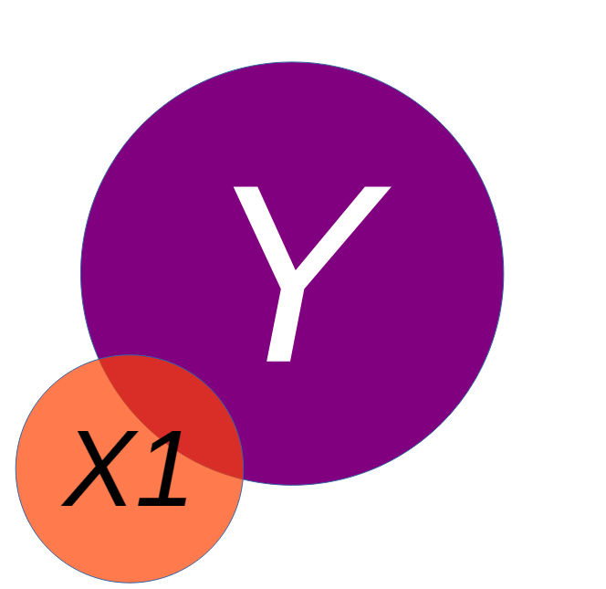
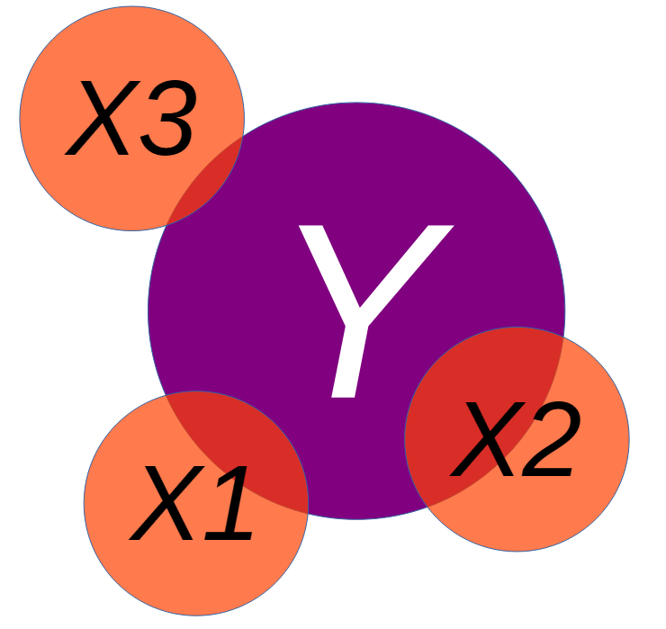
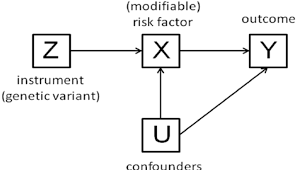
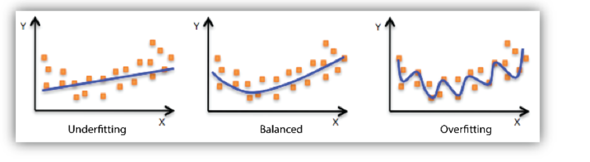

## Today...

**One predictor was never the plan.**

- Why a second predictor changes the first one's meaning
- "Holding constant" — what it actually does
- A slope that **flips sign** when we add the right variable
- Did the new predictor earn its place? ($\Delta R^2$, nested $F$)
- *b* or *β*: which one do you report?
- When predictors step on each other (multicollinearity)

```{r, results = 'hide', message = F, warning = F}
library(here)
library(tidyverse)
library(rio)
library(broom)
library(psych)
library(patchwork)

options(scipen = 999)
```

------------------------------------------------------------------------

## Today...

<https://bsky.app/profile/andrew.heiss.phd/post/3ly6hqr3mtk2z>

## {fig-align="center"}

## Where we have been

| Week | Model                                | What was new                     |
|-----------------|-----------------------------|--------------------------|
| 5    | $Y = b_0 + b_1X$                     | one continuous predictor         |
| 6    | $Y = b_0 + b_1D$                     | the predictor can be a **group** |
| 7    | $SS_{total} = SS_{model} + SS_{res}$ | how well the line fits           |

. . .

Everything so far has been **one predictor at a time**. That is almost never the model you want.

------------------------------------------------------------------------

### Regression

Overall, we are providing a model to give us a "best guess" on predicting our outcome

$$ Y_i = b_0 + b_1X_i + e_i $$

------------------------------------------------------------------------

## Explaining Variance

{fig-align="center"}

------------------------------------------------------------------------

### Explaining Variance


------------------------------------------------------------------------

### Explaining Variance



------------------------------------------------------------------------

## Model Interpretation

Once we have a model, we will be able to interpret the coefficients. For a bivariate regression (simple regression), this was fairly straightforward

We would look to the beta (effect size) and interpret it as: ***for every 1 unit increase in our X variable, there will be beta units increase in our Y variable.***

------------------------------------------------------------------------

## The only equation we need

$$Y_i = b_0 + b_1X_{1i} + b_2X_{2i} + \dots + b_kX_{ki} + e_i$$

::: incremental
- $b_0$ — predicted $Y$ when **every** predictor is 0
- $b_1$ — change in $Y$ per 1-unit change in $X_1$, **holding the other predictors constant**
- $e_i$ — still the part we miss
:::

. . .

::: callout-important
That phrase — *holding the other predictors constant* — is the entire week. It is not decoration. It changes what the number means.
:::

------------------------------------------------------------------------

### Explaining Variance



# Part 1: Why Bother?

------------------------------------------------------------------------

## You have been hired by the county 🚒

The fire department wants to know what drives the **cost of a fire**.

They hand you 300 fires: how many **trucks** were dispatched, how many **acres** burned, and the **damage** in thousands of dollars.

```{r}
#| code-fold: true
set.seed(640)
n <- 300

acres  <- round(runif(n, 0.5, 40), 1)
trucks <- round(1 + 0.22 * acres + rnorm(n, 0, 1.2))
trucks[trucks < 1] <- 1
damage <- 10 + 4.2 * acres - 2.8 * trucks + rnorm(n, 0, 12)

fire_data <- tibble(acres, trucks, damage)
```

```{r}
glimpse(fire_data)
```

------------------------------------------------------------------------

## Start where we always start

```{r, fig.height=3.6}
#| code-fold: true
fire_data %>%
  ggplot(aes(x = trucks, y = damage)) +
  geom_point(alpha = .5) +
  geom_smooth(method = "lm", se = FALSE, color = "#B3261E") +
  labs(x = "Trucks dispatched", y = "Damage ($1,000s)") +
  theme_bw(base_size = 16)
```

------------------------------------------------------------------------

### Bivariate relationship

This relationship can also be represented by a correlation, or a regression

```{r}
cor.test(fire_data$trucks, fire_data$damage)
## OR
fire.lm1 <- lm(damage ~ trucks, data = fire_data)
summary(fire.lm1)
```

------------------------------------------------------------------------

### Bivariate relationship

Based on the visualization, the correlation and the regression, what would we conclude from this analysis?

------------------------------------------------------------------------

### Bivariate relationship

> A linear regression was used to examine the impact of number of trucks on the scene and the amount of damage that was done by a fire. The number of trucks positively impacted the damage done by the fire (*b* = 11.67, *p* \< .001), suggesting that as more trucks are present, the fire does more damage.

. . .

> "Trucks strongly predict damage. **Send fewer trucks.**"

. . .

::: callout-warning
Every number in that sentence is correct. The recommendation would get people killed.
:::

------------------------------------------------------------------------

## 🧠 Side quest: draw the thing {background-color="#EFE6F7"}

Before you fit anything, sketch what you think is going on. Arrows for "causes."

- Does `trucks` → `damage`?
- Does something cause **both**?

. . .

A variable that causes both your predictor and your outcome is a **confound**. Leave it out and your slope absorbs its effect.

These sketches have a name. Remember when we talked about **Directed Acyclic Graphs (DAG's)**?

------------------------------------------------------------------------

## 🧠 Side quest: draw the thing {background-color="#EFE6F7"}

{fig-align="center" width="380"}

------------------------------------------------------------------------

## The variable we ignored

```{r, fig.height=3.6}
#| code-fold: true
fire_data %>%
  ggplot(aes(x = trucks, y = damage, color = acres)) +
  geom_point(alpha = .8) +
  scale_color_viridis_c(option = "inferno", direction = -1) +
  labs(x = "Trucks dispatched", y = "Damage ($1,000s)",
       color = "Acres\nburned") +
  theme_bw(base_size = 16)
```

Big fires get more trucks **and** do more damage. The slope we estimated was mostly **fire size wearing a truck costume**.

------------------------------------------------------------------------

## Put acres in the model

```{r}
fire.lm2 <- lm(damage ~ trucks + acres,
               data = fire_data)
summary(fire.lm2)
```

. . .

::: incremental
- `trucks`: **+12.73 → −2.63**. The sign *flipped*.
- `acres`: +4.09 per acre
- $R^2$: .672 → **.917**
:::

. . .

Each additional truck is associated with **\$2,630 less** damage — **among fires of the same size**.

------------------------------------------------------------------------

## What just happened

::::: columns
::: {.column width="50%"}
**Before**

We compared a 2-truck fire to a 9-truck fire. Those are not the same fire. One was a kitchen; one was a neighborhood.
:::

::: {.column width="50%"}
**After**

We compare 2-truck and 3-truck fires **of the same acreage**. Now the extra truck can only help.
:::
:::::

. . .

::: callout-important
## "Holding constant" is a comparison, not a magic word

$b_1$ answers: among cases that are **identical on every other predictor in the model**, what is the difference in $Y$ per unit of $X_1$?

Identical on the predictors you *included*. Nothing else.
:::

------------------------------------------------------------------------

### Fire Data: Formal Writeup

> "The current set of analyses sought to examine the influence of the number of firetrucks on the scene and the amount of damage that a fire caused, controlling for the size of the fire. The damage amount (in \\\$1,000s) was regressed on the number of firetrucks present and the size of the fire (in acres burned). The overall multiple regression was statistically significant ( $R^2$ = .92, *p* \< .001), meaning the two variables (Number of Trucks and Size of the Fire) accounted for 92% of the variance in damage done. Each of the two independent variables also had a statistically significant effect on damage (*p's* \< .001). The number of trucks was negatively related to the amount of damage done (*b* = -2.63), meaning that for each additional truck that was on the scene, there was a \$2,630 reduction in damage, controlling for the size of the fire. Additionally, the size of the fire increased the amount of damage by approximately \$4,000 for each additional acre burned. "

------------------------------------------------------------------------

## Omitted variables do not politely disappear

When you leave out a variable that is related to both $X$ and $Y$, its effect does not vanish — it gets **folded into** the coefficients you did estimate.

::: incremental
- Sometimes the slope is **inflated** (the trucks case)
- Sometimes it is **shrunk** (next week's tutoring example)
- Sometimes it appears out of nowhere (Lab 8's suppression)
- Sometimes **nothing moves** — and that is a finding too
:::

. . .

You cannot tell which from the output. You can only tell from **what you chose to measure**.

------------------------------------------------------------------------

## Goldilocks Problem

Models that are underfit, overfit or just-right

{fig-align="center"}

------------------------------------------------------------------------

## Another Example: Computer time & Frustration 💻 😠

::: callout-note
This example will focus mostly on the model comparisons
:::

```{r}
#| code-fold: true
#| 
# Step 1: Simulate the Data 
n <- 150 # Number of students

# Simulate total daily computer use in hours
computer_use <- rnorm(n, mean = 6, sd = 1.5)

# Simulate hours spent on stats homework, now as a whole number
stats_homework <- round(0.7 * computer_use + rnorm(n, 0, 1))
# Ensure no negative values after rounding
stats_homework[stats_homework < 0] <- 0
stats_homework[stats_homework > computer_use] <- 1

# Simulate frustration level (driven mostly by stats homework)
# Scale of 1-100
frustration <- 10 + (2 * computer_use) + (8 * stats_homework) + rnorm(n, 0, 10)

# Create a dataframe and clean up any impossible values
student_data <- tibble(
  frustration = frustration,
  computer_use = computer_use,
  stats_homework = stats_homework
) %>%
  filter(frustration > 0, computer_use > 0)

# Bin the 'stats_homework' variable
student_data <- student_data %>%
  mutate(
    stats_homework_bin = cut(stats_homework,
                           breaks = quantile(stats_homework, probs = seq(0, 1, by = 1/3)),
                           include.lowest = TRUE,
                           labels = c("Low", "Medium", "High"))
  )
```

We have collected data on graduate students and their weekly frustration levels. Data that were also collected included the amount of time they were spending on their computer as well as the amount of statistics homework that they had.

------------------------------------------------------------------------

### Frustration Model

Taking a bivariate look at things, we might have an initial model like this:

$$
Frustration=b_0 + b_1Comp.Hours + e_i
$$

------------------------------------------------------------------------

### Frustration Model

```{r}
#| code-fold: true

p1 <- student_data %>%
  ggplot(aes(x = computer_use, y = frustration)) +
  geom_point(alpha = 0.5) +
  geom_smooth(method = "lm",
              se = FALSE,
              color = "darkorange") +
  labs(
    title = "Frustration & Computer Use",
    subtitle = "Linear Fit",
    x = "Daily Computer Use (Hours)",
    y = "Frustration Level (1-100)"
  ) +
  theme_minimal()

p2 <- student_data %>%
  ggplot(aes(x = computer_use, y = frustration)) +
  geom_point(alpha = 0.5) +
  geom_smooth(method = "loess",
              se = FALSE,
              color = "darkorange") +
  labs(
    title = "Frustration & Computer Use",
    subtitle = "Loess Fit",
    x = "Daily Computer Use (Hours)",
    y = "Frustration Level (1-100)"
  ) +
  theme_minimal()

p1 + p2
```

------------------------------------------------------------------------

## What are the correlations?

```{r}
student_data %>% select(-stats_homework_bin) %>% cor() %>% round(3)
```

. . .

## Well that doesn't look nice...

------------------------------------------------------------------------

## What are the correlations? 💅

<https://strengejacke.github.io/sjPlot/reference/tab_corr.html>

```{r}
student_data %>% 
  select(-stats_homework_bin) %>% 
  sjPlot::tab_corr(var.labels = c("Frustration", "Computer Use", 
                                  "Statistics Homework"),
                   triangle = "lower")
```

------------------------------------------------------------------------

### Side Quest: Model Assumptions

1.  **Linearity** - A linear relationship exists between predictors and outcome
2.  **Multicollinearity** - The variables are minimally related to one another (VIF)
3.  **Independence of Observations** - Each observation in the model is independent of one another
4.  **Homoscedasticity of Residuals** - Residuals have constant variance across all points of the model
5.  **Multivariate Normality** - Residuals of the model are normally distributed (QQ Plots)

All of these are checked when using `check_model()` within the `easystats` library

------------------------------------------------------------------------

### Frustration Model: lm()

```{r}
frus.lm1 <- lm(frustration ~ computer_use, data = student_data)
summary(frus.lm1)
```

------------------------------------------------------------------------

### Frustration Model: Multivariate

```{r}
#| code-fold: true
#| 
ggplot(student_data, aes(x = computer_use, y = frustration, color = stats_homework_bin)) +
  geom_point(alpha = 0.8, size = 2) +
  labs(
    title = "Frustration & Computer Use by Stats",
    x = "Daily Computer Use (Hours)",
    y = "Frustration Level (1-100)",
    color = "Stats HW (Hours)"
  ) +
  theme_minimal()
```

------------------------------------------------------------------------

### Frustration Model: Multivariate

```{r}
#| code-fold: true
#| 
student_data %>% 
  ggplot(aes(x = computer_use, y = frustration, 
             color = stats_homework_bin)) +
    geom_point(alpha = 0.5) +
    # Fit a line FOR EACH GROUP to show the true relationship
    geom_smooth(method = "lm", se = FALSE) +
    labs(
      title = "Frustration & Computer Use by Stats",
      x = "Daily Computer Use (Hours)",
      y = "Frustration Level (1-100)",
      color = "Stats HW (Hours)"
    ) +
    theme_bw()
```

------------------------------------------------------------------------

### Frustration Model

```{r}
frus.lm2 <- lm(frustration ~ computer_use + stats_homework,
               data = student_data)
summary(frus.lm2)
```

------------------------------------------------------------------------

### Comparing Models

Maybe we would like to test to see if including the Stats Homework variable improved the model

Since the first regression is *nested* within the second, we can run an ANOVA

```{r}
anova(frus.lm1, frus.lm2)
```

------------------------------------------------------------------------

| Statistic | Meaning | Interpretation |
|------------------------|------------------------|------------------------|
| `Res.Df` (Residual Degrees of Freedom) | Remaining degrees of freedom after estimating parameters | 148 for Model 1, 147 for Model 2 (one more parameter estimated) |
| `RSS` (Residual Sum of Squares) | Total unexplained variance by the model | Decreases substantially from 24,468 → 13,620 with the new predictor, showing improved fit |
| `Df` (Difference in df) | Number of parameters added | 1 (adding `stats_homework`) |
| `Sum of Sq` (Difference in RSS) | Variance explained by the added predictor | 10,848 units of variance explained by `stats_homework` |
| `F` | F-statistic testing whether this variance reduction is significant | 117.07 — very large, meaning substantial improvement |
| `Pr(>F)` | p-value associated with F |  |

------------------------------------------------------------------------

## Model Assumptions: Frustration

```{r}
performance::check_model(frus.lm2)
```

------------------------------------------------------------------------

### Model Assumptions

1.  **Linearity** - A linear relationship exists between predictors and outcome
    1.  Apply Transformation (square root or log); Drop the variable
2.  **Multicollinearity** - The variables are minimally related to one another (VIF)
    1.  Remove variable; different type of regression (lasso, partial least squares)
3.  **Independence of Observations** - Each observation in the model is independent of one another
    1.  Dummy coding, lags; Use MLM
4.  **Homoscedasticity of Residuals** - Residuals have constant variance across all points of the model
    1.  Apply Transformation (square root or log);
5.  **Multivariate Normality** - Residuals of the model are normally distributed (QQ Plots)
    1.  Check for outliers; Apply Transformation (square root or log)

------------------------------------------------------------------------

## Model Selection - Stepwise

- *Backward elimination*

  - Start with the full model (all potential predictors)

  - Predictors eliminated one-at-a-time from the model until we cannot improve the model any further

- *Forward selection*

  - Start with nothing in the model

  - Continue to add predictors one-at-a-time until we cannot find any predictors that improve the model any further

------------------------------------------------------------------------

## Model Selection

**ALWAYS** start with theory and previous work

You should NEVER just go into data with just a lot of predictors and backward selection in mind. 🧨

------------------------------------------------------------------------

## One More Example - Bringing it together

520 students, one survey 😵‍💫

A student-stress survey: everything rated 1–5. The column names are, charitably, a disaster — so we rename by position.

```{r}
stress <- import(here("files", "data", "student_stress.xlsx")) %>%
  set_names(c("sleep_quality", "headaches", "academic_perf",
              "study_load", "extracurricular", "stress"))

stress %>% describe(fast = TRUE)
```

------------------------------------------------------------------------

## Who correlates with stress?

```{r}
stress %>% 
  sjPlot::tab_corr(var.labels = c("Sleep Quality", "Headaches", 
                                  "Academic Performance", "Study Load", 
                                  "Extracurricular", "Stress"),
                   triangle = "lower")
```

::: incremental
- `study_load` is the obvious candidate: *r* = **.39**
- `sleep_quality` is next: *r* = **.17**
- And the two predictors barely know each other: *r* = **.065**
:::

------------------------------------------------------------------------

## Model 1: study load alone

```{r}
s_one <- lm(stress ~ study_load, data = stress)
summary(s_one)
```

. . .

Each 1-point increase in study load → **0.39** points more stress. $R^2$ = **.153**.

------------------------------------------------------------------------

## Model 2: add sleep quality

```{r}
s_two <- lm(stress ~ study_load + sleep_quality, data = stress)
tidy(s_two)
```

. . .

| Predictor       | Alone | Together  |
|-----------------|-------|-----------|
| `study_load`    | 0.388 | **0.378** |
| `sleep_quality` | —     | **0.174** |

The study-load slope moved by **0.01**. Essentially nothing.

------------------------------------------------------------------------

## Why nothing moved

A coefficient only changes when the new predictor is related to **both** the outcome and the old predictor.

```{r}
cor.test(stress$study_load, stress$sleep_quality)
```

::: incremental
- *r* = .065 → the two predictors carry **separate** information
- So each one keeps the effect it had on its own
- Their contributions simply **add**
:::

. . .

::: callout-tip
"I added a predictor and the first one didn't budge" is a **real result**, and it is the common one. It means your two predictors are not competing for the same variance. Say that, instead of apologizing for it.
:::

------------------------------------------------------------------------

## Interpreting Model 2 out loud

$$\widehat{Stress} = 1.29 + 0.378(StudyLoad) + 0.174(SleepQuality)$$

::: incremental
- **1.29** — predicted stress for a student who rated study load *and* sleep quality as 0. **Neither is possible** (the scale starts at 1), so this intercept is a mathematical anchor, not a person.
- **0.378** — comparing two students with the **same sleep quality**, one point more study load goes with 0.38 points more stress
- **0.174** — comparing two students with the **same study load**, one point more sleep quality goes with 0.17 points more stress
:::

------------------------------------------------------------------------

## Wait. Read that last one again. 🤨

**Better sleep quality predicts *more* stress** (*b* = +0.174, *p* \< .001), holding study load constant.

. . .

Three possibilities, and you cannot choose between them from this output:

::: incremental
1.  The item is scored **backwards** — maybe 5 means "I rate my sleep quality as a problem"
2.  The relationship is real and reflects something else (students who sleep well take on more)
3.  The survey question was ambiguous and students interpreted it inconsistently
:::

. . .

::: callout-important
This is the midterm's lesson arriving in a lecture. **Check the direction of every coefficient against what you expected.** When it disagrees, the first suspect is always scoring — not the universe.
:::

# Part 3: Did It Earn Its Place?

------------------------------------------------------------------------

## Three ways to ask the same question

```{r}
glance(s_one) %>% select(r.squared, adj.r.squared, sigma)
glance(s_two) %>% select(r.squared, adj.r.squared, sigma)
```

| Model            | $R^2$     | adj. $R^2$ | RSE        |
|------------------|-----------|------------|------------|
| study load       | .1534     | .1517      | 1.2506     |
| \+ sleep quality | **.1730** | **.1698**  | **1.2372** |

::: incremental
- $\Delta R^2$ = **.0196** — about 2% more of stress accounted for
- Adjusted $R^2$ went **up**, so the predictor paid its own df
- Typical miss shrank from 1.251 to 1.237 (on a variable with SD = 1.358)
:::

------------------------------------------------------------------------

## The formal test: nested models

Model 1 is **nested** inside Model 2 — same data, same outcome, Model 1 is Model 2 with one coefficient forced to zero. That lets us test the difference directly.

```{r}
anova(s_one, s_two)
```

------------------------------------------------------------------------

## Reading that table

| Column      | What it is                      | Here            |
|-------------|---------------------------------|-----------------|
| `Res.Df`    | df left after estimating        | 518 → 517       |
| `RSS`       | unexplained SS                  | 810.12 → 791.34 |
| `Df`        | predictors added                | 1               |
| `Sum of Sq` | SS the new predictor picked up  | **18.78**       |
| `F`         | is that drop bigger than noise? | **12.27**       |
| `Pr(>F)`    | the *p*-value                   | **.0005**       |

. . .

With one added predictor, this $F$ is just the square of its $t$: $3.503^2 = 12.27$. Same test, different table. ✅

------------------------------------------------------------------------

## Now let's add three useless things

```{r}
s_junk <- lm(stress ~ study_load + sleep_quality +
               extracurricular + headaches + academic_perf,
             data = stress)
tidy(s_junk)
```

Extracurriculars (*p* = .70), headaches (*p* = .10), academic performance (*p* = .48).

------------------------------------------------------------------------

## Watch the two R²s diverge

| Model        | $R^2$        | adj. $R^2$   | RSE    |
|--------------|--------------|--------------|--------|
| 2 predictors | .1730        | .1698        | 1.2372 |
| 5 predictors | **.1779** ⬆️ | **.1699** ➡️ | 1.2371 |

::: incremental
- $R^2$ rose by .005, because **it always rises**
- Adjusted $R^2$ moved by **.0001** — three predictors bought you nothing
- RSE: unchanged to four decimals
:::

. . .

::: callout-important
Week 7's warning, now with consequences. $R^2$ cannot tell you whether a predictor belongs in the model. **Adjusted** $R^2$, the nested $F$, and your theory can.
:::

# Part 4: Reporting It

------------------------------------------------------------------------

## *b* or *β*?

```{r}
stress %>%
  mutate(across(everything(), ~ as.numeric(scale(.x)))) %>%
  lm(stress ~ study_load + sleep_quality, data = .) %>%
  tidy() %>%
  select(term, estimate)
```

::::: columns
::: {.column width="50%"}
**Report *b* when**

- the units mean something (dollars, hours, mg)
- you want to compare predictors **within** this sample
:::

::: {.column width="50%"}
**Report *β* when**

- the units are arbitrary (survey points)
- you want to compare **across** studies or scales
:::
:::::

. . .

Here: β = **.38** vs **.14**. Study load matters roughly **2.7×** as much as sleep quality for stress.

------------------------------------------------------------------------

## When predictors step on each other

If two predictors are nearly the same variable, the model cannot tell them apart. Coefficients get unstable and standard errors balloon.

**VIF** (variance inflation factor) measures it: $VIF_j = \frac{1}{1 - R^2_j}$, where $R^2_j$ is from regressing predictor $j$ on all the others.

With two predictors you can compute it by hand — regress one predictor on the other:

```{r}
# stress model
1 / (1 - summary(lm(study_load ~ sleep_quality, data = stress))$r.squared)

# fire model
1 / (1 - summary(lm(trucks ~ acres, data = fire_data))$r.squared)
```

::: incremental
- Stress model: VIF = **1.004** — these predictors are strangers
- Fire model: VIF = **5.00** — acres and trucks are nearly redundant (*r* = .89), and the SE on `trucks` rose from 0.515 to 0.579 as a result
:::

. . .

Rules of thumb: \> 5 is worth a sentence, \> 10 is a problem. Note that the fire model still **worked** — high VIF widens your SEs, it does not invalidate the model.

------------------------------------------------------------------------

## Checking the Model - Easy

There are a lot of ways to take a look at the model

One of the easiest ways is to use `performance` and their `check_model()` function

```{r}
performance::check_model(s_junk)
```

------------------------------------------------------------------------

## The write-up

> [Stress was regressed on self-reported study load and sleep quality]{.underline} in a sample of 520 students. The overall model was significant, *F*(2, 517) = 54.07, *p* \< .001, accounting for 17.3% of the variance in stress (adj. *R²* = .170). Holding sleep quality constant, each one-point increase in study load was associated with a 0.38-point increase in stress (*b* = 0.38, *SE* = 0.04, *t* = 9.54, *p* \< .001). Holding study load constant, each one-point increase in rated sleep quality was associated with a 0.17-point increase in stress (*b* = 0.17, *SE* = 0.05, *t* = 3.50, *p* \< .001). Adding sleep quality improved fit over study load alone, Δ*R²* = .020, *F*(1, 517) = 12.27, *p* \< .001. The positive coefficient for sleep quality was contrary to expectation and may reflect the direction in which that item was scored.

. . .

::: callout-tip
Everything a reader needs: the overall test, each coefficient **with its holding-constant clause**, the model comparison, and an honest flag on the odd result.
:::

------------------------------------------------------------------------

## 🛠️ Activity: Does Spending More Make More?

::: callout-tip
**Week 8 Exercises** · \~45 min · Pairs
:::

1,763 films, 1970–2013: budget, international gross, year, and whether the film passes the Bechdel test.

- Budget alone explains **35%** of gross
- Add **one** more variable and the budget slope gets *bigger*
- You will find out why, and write it up like a consultant

[Open the activity](../class-activities/wk8_multiple-reg.html){.button target="_blank"}

------------------------------------------------------------------------

## ✍️ Wrap-Up

Finish these at the bottom of your activity file:

1.  In your own words: what does "holding X constant" let you compare?
2.  A colleague says "my $R^2$ went up, so the new predictor helped." What do you ask them for?
3.  One thing that is still muddy → journal.

------------------------------------------------------------------------

## For next time

::: callout-important
## 📂 Midterm Project — due Tuesday 10/27 at 11:59pm

**Part 6 is now unlocked.** You have everything you need: the two-predictor model, the "holding constant" interpretation, $\Delta R^2$, and the model-comparison table.

Target for this weekend: Parts 1–5 done, Part 6 drafted. That leaves next week for writing instead of panicking.
:::

**No lab is due this week or next** — the midterm is the assignment.

📖 Chapter 14.3 — ST · Chapter 8.1 — MSR

**Next week:** what happens when the groups from Week 6 meet the predictors from this week — and what to do when a slope is *different* for different groups.
