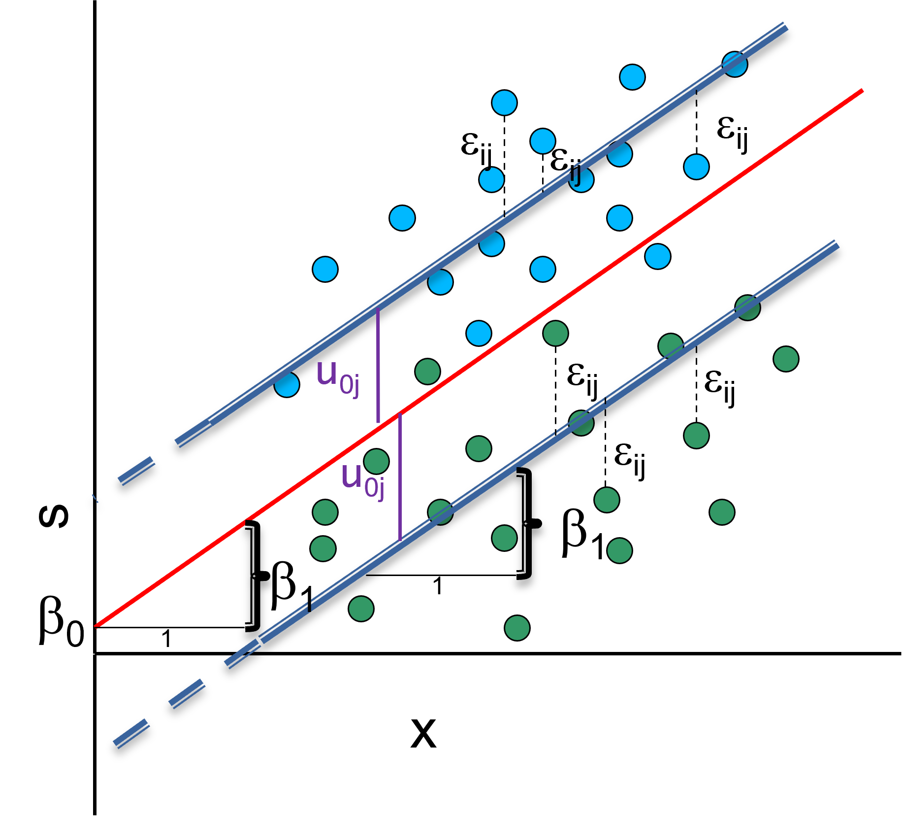
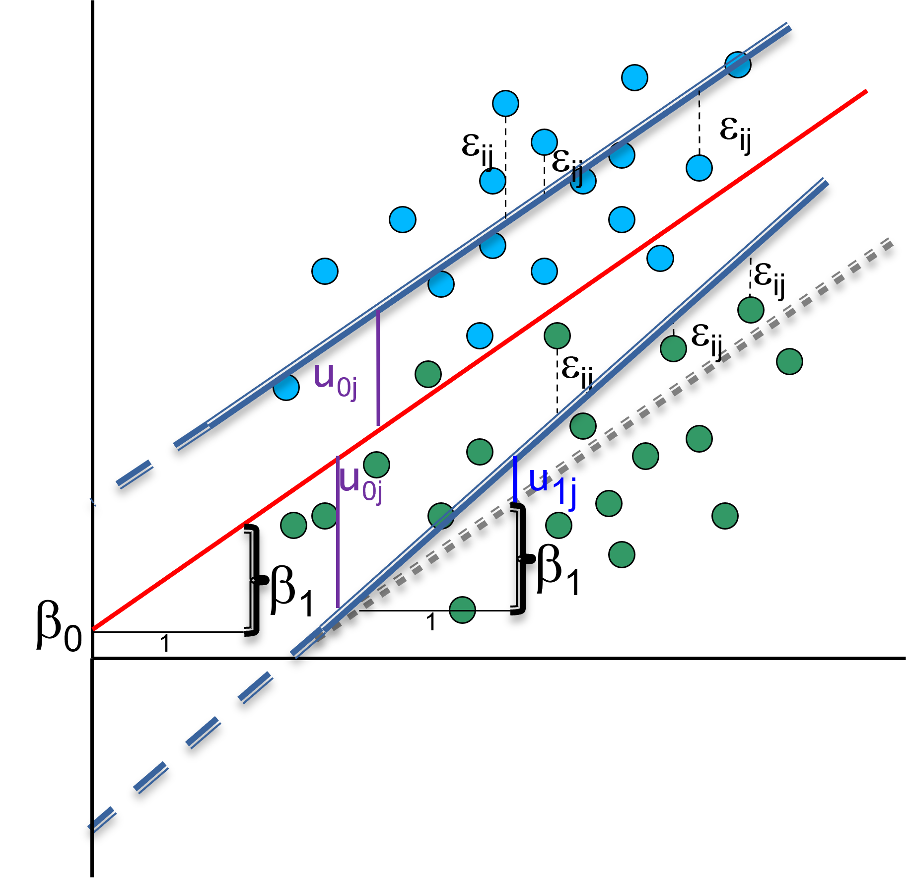

## 💾 Class Check 5

::: callout-important
**20 minutes** · On myCourses

Covers Weeks 11–12: missing data, building models in blocks, and logistic regression. Start when I say go.
:::

When you finish: open today's activity and do the **Set up** section so you're ready for Part A.

[Open the activity](../class-activities/wk13_mixed-models.html){.button target="_blank"}

------------------------------------------------------------------------

## Today...

**When the same person shows up more than once**

- Wide → long: one row per **observation**, not per person
- Why `lm()` gets the standard errors wrong when rows aren't independent
- **Random intercepts**: everyone gets their own starting point
- The **ICC**: how much of the variance is "who you are"
- **Random slopes**: everyone gets their own line
- Two kinds of predictors: **between** people and **within** a person

. . .

::: callout-tip
## The plan for class

|                     |                       |
|---------------------|-----------------------|
| 💾 Class Check 5    | 20 min                |
| Lecture             | \~45 min              |
| 😴 Activity         | \~20 min              |
| ☕ Break            |                       |
| 📂 **M3 work time** | **the rest of class** |
:::

------------------------------------------------------------------------

```{r, results = 'hide', message = F, warning = F}
library(tidyverse)
library(rio)
library(here)
library(broom)
library(easystats)
library(lme4)       # lmer()
library(lmerTest)   # adds df and p-values to lmer()

options(scipen = 999)

asap <- import(here("files", "data", "asap_data.csv"))
```

::: callout-note
New packages today: `install.packages(c("lme4", "lmerTest"))`. Load `lmerTest` **after** `lme4`.
:::

# Part 1: One Kid, Three Rows

------------------------------------------------------------------------

## The ASAP study, one last time 😴

400 kids, measured at **three waves**, one year apart: sleep, stress, depression, anxiety.

So far we've used **one wave at a time**: predict Time 3 from Time 1, one row per kid.

. . .

Today's question uses **all three waves at once**:

> Does depression go up as kids get older? And do girls report more of it?

. . .

To answer it, every **observation** needs its own row.

------------------------------------------------------------------------

## Wide → long

```{r}
asap_long <- asap %>%
  pivot_longer(starts_with("T"),
               names_to = c("wave", ".value"),       # "T2_Dep" → wave = 2, column = Dep
               names_pattern = "T(\\d)_(.*)") %>%
  mutate(wave = as.numeric(wave) - 1)                # 0, 1, 2 = years since the first visit

asap_long %>%
  filter(ID %in% 1:2) %>%
  select(ID, Sex, wave, Age, SleepQual, Dep)
```

. . .

- **Wide**: one row per kid, `T1_Dep`, `T2_Dep`, `T3_Dep`. Good for `lm()` with one time point.
- **Long**: one row per kid **per wave**. What every multilevel model wants.
- `Sex` and `SES` repeat on every row. They don't change.

------------------------------------------------------------------------

## 1,200 rows. 400 kids.

```{r}
asap_long %>%
  summarise(rows = n(),
            rows_with_dep = sum(!is.na(Dep)),
            kids = n_distinct(ID))
```

. . .

The rows are **not independent**. A kid who's high at wave 0 tends to stay high:

```{r, fig.width=9, fig.height=4}
#| code-fold: true
#| out-width: "75%"
#| warning: false
set.seed(13)
some_kids <- sample(unique(asap_long$ID), 25)

asap_long %>%
  filter(ID %in% some_kids, !is.na(Dep)) %>%
  ggplot(aes(wave, Dep, group = ID)) +
  geom_line(alpha = 0.4) +
  geom_point(alpha = 0.4) +
  stat_summary(aes(group = 1), data = asap_long, fun = mean,
               geom = "line", color = "#C8102E", linewidth = 1.5) +
  scale_x_continuous(breaks = 0:2) +
  labs(x = "Wave (years since first visit)", y = "Depression") +
  theme_bw(base_size = 15)
```

Each gray line is one kid. Red is the average.

------------------------------------------------------------------------

## What `lm()` does with this

```{r}
m_lm <- lm(Dep ~ wave + Sex, data = asap_long)
tidy(m_lm)
```

. . .

`lm()` thinks it has **`r nobs(m_lm)` independent kids**. It has 400.

. . .

::: callout-warning
Asking one person the same question three times is not three people. `lm()` counts it as three, so it's **too confident**: standard errors too small, *p*-values too small. (Week 10's assumption #4, **independence**, the one no plot can fix.)
:::

# Part 2: Random Intercepts

------------------------------------------------------------------------

## The idea

Give every kid **their own intercept**, and let the model estimate how much those intercepts vary.

$$
\text{Dep}_{ij} = (b_0 + u_{j}) + b_1\,\text{wave}_{ij} + e_{ij}
$$

. . .

| Piece | What it is |   |
|:--------|:-----------------------|:-----------------------|
| *b*~0~, *b*~1~ | **Fixed effects**: one number for everyone | the average kid |
| *u~j~* | Kid *j*'s **random intercept**: how far they sit above or below average | between kids |
| *e~ij~* | What's left at each wave | within a kid |

. . .

Two sources of variation instead of one. That's the whole trick.

------------------------------------------------------------------------

{fig-align="center" width="691"}

------------------------------------------------------------------------

## `lmer()`: one new piece of syntax

```{r}
m0 <- lmer(Dep ~ 1 + (1 | ID), data = asap_long)
```

. . .

- `(1 | ID)`: read it as **"an intercept that varies by ID"**
- Everything to the left of `(` is the same formula you've written all semester
- `lmer` = **l**inear **m**ixed-**e**ffects **r**egression. *Mixed* = fixed + random.

. . .

Multilevel, mixed, hierarchical, random-effects: **same model, different fields.**

------------------------------------------------------------------------

## How much is "who you are"? The ICC

```{r}
icc(m0)
```

```{r}
#| echo: false
vc0 <- as.data.frame(VarCorr(m0))
icc0 <- vc0$vcov[1] / sum(vc0$vcov)
```

. . .

The **intraclass correlation**: the share of variance that sits **between** kids.

$$
\text{ICC} = \frac{\text{between-kid variance}}{\text{between} + \text{within}} = \frac{`r sprintf("%.2f", vc0$vcov[1])`}{`r sprintf("%.2f", vc0$vcov[1])` + `r sprintf("%.2f", vc0$vcov[2])`} = `r sub("^0", "", sprintf("%.2f", icc0))`
$$

. . .

- About **`r round(100 * icc0)`%** of the differences in depression are stable differences between kids.
- The other `r 100 - round(100 * icc0)`% is change from wave to wave, plus noise.
- ICC = 0: the rows really are independent, and `lm()` would be fine. Here it isn't 0.

------------------------------------------------------------------------

## Add the predictors

```{r}
m1 <- lmer(Dep ~ wave + Sex + (1 | ID), data = asap_long)
model_parameters(m1)
#summary(m1)
```

. . .

- **Fixed effects** read exactly like `lm()`: depression rises about **`r sprintf("%.2f", fixef(m1)["wave"])` points per year**, holding sex constant.
- **Random effects**: kids' intercepts have an SD of **`r sprintf("%.2f", as.data.frame(VarCorr(m1))$sdcor[1])`** around that average.

------------------------------------------------------------------------

## Same estimates, different confidence

```{r}
#| echo: false
s_lm <- summary(m_lm)$coefficients
s_m1 <- summary(m1)$coefficients
f2 <- function(x) sprintf("%.2f", x)
f3 <- function(x) sprintf("%.3f", x)
fp <- function(p) if (p < .001) "< .001" else sub("^0", "", sprintf("%.3f", p))
```

|   | `lm()` |   |   | `lmer()` |   |   |
|:----------|:---------:|:---------:|:---------:|:---------:|:---------:|:---------:|
|  | *b* | *SE* | *p* | *b* | *SE* | *p* |
| **wave** (changes within a kid) | `r f2(s_lm["wave", 1])` | `r f3(s_lm["wave", 2])` | `r fp(s_lm["wave", 4])` | `r f2(s_m1["wave", 1])` | **`r f3(s_m1["wave", 2])`** | `r fp(s_m1["wave", 5])` |
| **Sex** (same on every row) | `r f2(s_lm["Sex", 1])` | `r f3(s_lm["Sex", 2])` | **`r fp(s_lm["Sex", 4])`** | `r f2(s_m1["Sex", 1])` | **`r f3(s_m1["Sex", 2])`** | **`r fp(s_m1["Sex", 5])`** |

. . .

- **Sex** is a **between-kid** predictor. `lm()` counted each girl three times. Fixed: SE goes **up**, and *p* crosses .05. One model says "girls report more depression"; the honest one says "we can't tell."
- **wave** is a **within-kid** predictor. Once each kid's baseline is pulled out, the wave-to-wave noise is smaller, so SE goes **down**.

. . .

::: callout-important
Ignoring the nesting doesn't just make you overconfident. It makes you wrong in **both** directions, depending on the level of the predictor.
:::

------------------------------------------------------------------------

## Fixed vs. random

|   | Fixed effect | Random effect |
|:-----------------------|:-----------------------|:-----------------------|
| What it is | One number for everyone | How much people **differ** |
| ASAP example | Average change per year: `r f2(fixef(m1)["wave"])` | SD of kids' intercepts: `r f2(as.data.frame(VarCorr(m1))$sdcor[1])` |
| The question it answers | "What happens on average?" | "How much do kids vary around that?" |
| You report | *b*, CI, *p* | SD (or variance), and the ICC |

. . .

**When is something random?** When the levels are a **sample** from a bigger population you want to generalize to: kids, classrooms, therapists, schools, days. You don't care about kid #217 in particular.

------------------------------------------------------------------------

## Partial pooling: borrowing strength

What's each kid's "usual" depression? Three ways to estimate it:

::: incremental
- **Complete pooling**: everyone gets the grand mean. (`lm()` with no ID.) Ignores real differences.
- **No pooling**: each kid's own average. Noisy, especially for kids with one wave.
- **Partial pooling**: each kid's average, **pulled toward the grand mean**. The fewer waves a kid has, the harder the pull. That's what `lmer()` does.
:::

------------------------------------------------------------------------

## Shrinkage, in a picture

```{r, fig.width=9, fig.height=4.5}
#| code-fold: true
#| out-width: "60%"
#| message: false
pool <- asap_long %>%
  filter(!is.na(Dep)) %>%
  group_by(ID) %>%
  summarise(no_pool = mean(Dep), waves = n()) %>%
  left_join(coef(m0)$ID %>% rownames_to_column("ID") %>%
              mutate(ID = as.numeric(ID)) %>%
              rename(partial = `(Intercept)`), by = "ID")

pool %>%
  ggplot(aes(no_pool, partial, color = factor(waves))) +
  geom_abline(slope = 1, intercept = 0, linetype = "dashed") +
  geom_point(alpha = 0.5) +
  geom_smooth(method = "lm", se = FALSE, linewidth = 1.2) +
  coord_equal() +
  labs(x = "Kid's own mean (no pooling)", y = "lmer estimate (partial pooling)",
       color = "Waves observed") +
  theme_bw(base_size = 14)
```

Dashed line = no shrinkage. Every kid gets pulled toward the average (the lines are flatter than the dashed one), and kids seen **once** get pulled hardest. The model trusts the kids it knows more about.

------------------------------------------------------------------------

## A gift from Week 11: missing waves

```{r}
asap_long %>%
  filter(!is.na(Dep)) %>%
  count(ID, name = "waves") %>%
  count(waves, name = "kids")
```

. . .

- Week 11: `lm(T3_Dep ~ T1_Dep ...)` **dropped every kid missing Time 3**. Listwise deletion.
- `lmer()` on long data uses **every row it has**. A kid seen twice still contributes two rows, and still counts.
- That's valid under **MAR**: missingness can depend on anything in the model, including that kid's earlier depression.

. . .

::: callout-tip
For longitudinal data, a mixed model is often the simplest honest answer to "what do I do about dropout?"
:::

# Part 3: Random Slopes

------------------------------------------------------------------------

## Does everyone change at the same rate?

Random intercepts give every kid their own **starting point**, but the **same slope**. Parallel lines.

```{r, fig.width=10, fig.height=4}
#| code-fold: true
#| out-width: "85%"
set.seed(19)
sim <- expand_grid(person = 1:15, time = 0:9) %>%
  group_by(person) %>%
  mutate(u0 = rnorm(1, 0, 25), u1 = rnorm(1, 0, 6)) %>%
  ungroup() %>%
  mutate(`Random intercepts only` = 250 + u0 + 10 * time,
         `Random intercepts + slopes` = 250 + u0 + (10 + u1) * time) %>%
  pivot_longer(starts_with("Random"), names_to = "model", values_to = "y") %>%
  mutate(model = fct_rev(model))

ggplot(sim, aes(time, y, group = person)) +
  geom_line(alpha = 0.6) +
  facet_wrap(~ model) +
  labs(x = "Time", y = "Outcome") +
  theme_bw(base_size = 15)
```

. . .

Random **slopes** let each person have their own rate of change, and estimate how much those rates vary.

------------------------------------------------------------------------

{width="647"}

------------------------------------------------------------------------

## The syntax

```{r, eval = FALSE}
lmer(Dep ~ wave + Sex + (1 | ID), data = asap_long)      # random intercepts
lmer(Dep ~ wave + Sex + (wave | ID), data = asap_long)   # random intercepts + slopes for wave
```

. . .

`(wave | ID)`: **"the intercept and the effect of wave both vary by ID."** (The 1 is implied.)

. . .

Only **within-person** predictors can have random slopes. `(Sex | ID)` makes no sense: Sex doesn't change within a kid, so there's no kid-specific slope to estimate.

------------------------------------------------------------------------

## Try it on ASAP

```{r}
#| warning: true
#| message: true
m2 <- lmer(Dep ~ wave + Sex + (wave | ID), data = asap_long)
```

. . .

```{r}
VarCorr(m2)
```

. . .

**"Singular fit"** plus a correlation of **1.00** between intercepts and slopes: the model is asking for more than the data can tell it.

- Each kid has **at most 3 points**. Three points barely pin down one line per kid, let alone how much the lines vary.
- Don't report this model. **Simplify** (back to random intercepts) and say so.

. . .

::: callout-tip
A warning from `lmer()` is information, not noise. You'll fit random slopes that **work** in the activity, with 10 observations per person.
:::

# Part 4: Two Kinds of Predictors

------------------------------------------------------------------------

## Between and within

| Predictor |        Changes within a kid?        | Can tell you about...        |
|:---------------------|:---------------------------:|:---------------------|
| Sex, SES  |                 No                  | Differences **between** kids |
| wave      |           Yes, by design            | Change **within** a kid      |
| SleepQual | **Yes, and** kids differ on average | **Both**, mixed together     |

. . .

A time-varying predictor like `SleepQual` carries two questions:

1.  **Between**: are kids who *usually* score higher on SleepQual more depressed?
2.  **Within**: in a year when a kid scores higher **than their own usual**, are they more depressed than usual?

These can have **different answers**.

------------------------------------------------------------------------

## The blended estimate

```{r}
m_sq <- lmer(Dep ~ wave + Sex + SleepQual + (1 | ID), data = asap_long)
model_parameters(m_sq)
```

One slope, **`r sprintf("%.2f", fixef(m_sq)["SleepQual"])`**. Between, within, or some average of the two? You can't tell.

------------------------------------------------------------------------

## Split it

```{r}
asap_long <- asap_long %>%
  group_by(ID) %>%
  mutate(sq_kid_mean = mean(SleepQual, na.rm = TRUE),      # the kid's usual level
         sq_within   = SleepQual - sq_kid_mean) %>%        # this wave vs. their usual
  ungroup() %>%
  mutate(sq_between = sq_kid_mean - mean(sq_kid_mean, na.rm = TRUE))  # kid's usual vs. other kids

m_split <- lmer(Dep ~ wave + Sex + sq_between + sq_within + (1 | ID), data = asap_long)
model_parameters(m_split)
```

```{r}
#| echo: false
ss <- summary(m_split)$coefficients
```

. . .

- **Between**: *b* = `r f2(ss["sq_between", 1])`, *p* `r if (ss["sq_between", 5] < .001) "< .001" else paste("=", fp(ss["sq_between", 5]))`. Kids with higher usual SleepQual scores report more depression.
- **Within**: *b* = `r f2(ss["sq_within", 1])`, *p* = `r fp(ss["sq_within", 5])`. A year above your own usual SleepQual? No change in depression.
- The blended `r f2(fixef(m_sq)["SleepQual"])` answered **neither** question.

------------------------------------------------------------------------

## **Two kinds of centering, two different jobs**

- **Person-mean centering:** `SleepQual − kid's mean` → the **within** effect

- **Grand-mean centering:** `kid's mean − mean of all kids` → the **between** effect, with an intercept for the average kid

- Grand-mean centering raw SleepQual **doesn’t** separate the two; it only shifts the intercept (Week 9 callback)

------------------------------------------------------------------------

## Why this matters

::: callout-important
**Between-person** effects describe how **people differ**. **Within-person** effects describe how **a person changes**. Most psychological theories are about the second; most cross-sectional data can only show the first.
:::

. . .

- "People who sleep worse are more depressed" ≠ "if *you* sleep worse, *you'll* get more depressed."
- Repeated measures are what let you ask the within-person question at all.
- Person-mean centering (what we just did) is how you keep the two apart.

# Part 5: Writing It Up

------------------------------------------------------------------------

## What a reader needs

1.  **Two sample sizes**: people **and** observations
2.  The **random-effects structure** (intercepts only? slopes for what?) and why
3.  The **ICC** from the null model
4.  **Fixed effects** with 95% CIs, like any regression
5.  **Fit**: marginal and conditional *R*²

```{r}
r2(m1)
```

. . .

- **Marginal *R*²**: variance explained by the **fixed** effects alone.
- **Conditional *R*²**: fixed **plus** random effects. The gap is how much "which kid" explains.

------------------------------------------------------------------------

## The paragraph

```{r}
#| echo: false
mp <- model_parameters(m1)
r2m <- r2(m1)
n_obs <- nobs(m1)
fci <- function(i) sprintf("95%% CI [%.2f, %.2f]", mp$CI_low[i], mp$CI_high[i])
```

> Because each child contributed up to three observations, we fit a linear mixed model with random intercepts for child using the `lme4`(Bates, et. al, 2015). The model used `r n_obs` observations from 400 children across 3 waves of data. In a null model, `r round(100 * icc0)`% of the variance in depression was between children (ICC = `r sub("^0", "", sprintf("%.2f", icc0))`). Depression increased by `r f2(mp$Coefficient[2])` points per year, `r fci(2)`, *p* `r if (mp$p[2] < .001) "< .001" else paste("=", fp(mp$p[2]))`. Girls and boys did not differ reliably, *b* = `r f2(mp$Coefficient[3])`, `r fci(3)`, *p* = `r fp(mp$p[3])`. Fixed effects explained `r round(100 * r2m$R2_marginal)`% of the variance (marginal *R*²); including child-level differences, `r round(100 * r2m$R2_conditional)`% (conditional *R*²). A model adding random slopes for wave was singular, so we retained random intercepts only.

::: callout-note
You should always cite the libraries that you use in R. This gives the developers credit. You can find the citation of any package using `citation()`
:::

------------------------------------------------------------------------

## Three ways to get it wrong

::: incremental
1.  **Treating rows as people.** If anyone appears more than once, `lm()` is overconfident about anything that's constant within a person. Check: does `n_distinct(ID)` equal `nrow()`?
2.  **Ignoring a singular-fit warning.** It means a random effect is estimated at (or near) zero, or two are perfectly correlated. Simplify the random part and report that you did.
3.  **Blending between and within.** A time-varying predictor entered raw gives you a mix of two questions. Split it with person-mean centering when the difference matters to your theory.
:::

------------------------------------------------------------------------

## `lm()` vs. `lmer()`, side by side

|   | `lm()` | `lmer()` |
|:-----------------------|:-----------------------|:-----------------------|
| Data | One row per person | One row per **observation** (long) |
| Assumes | Every row independent | Rows **within a cluster** are related |
| R | `lm(y ~ x)` | `lmer(y ~ x + (1 | id))` |
| Coefficients | *b* | **Fixed effects**: read the same as *b* |
| Extra output | — | **Random effects**: SDs, the ICC |
| Compare models | `anova()` → *F* | `anova()` → χ² (likelihood ratio) |
| Fit | *R*² | Marginal and conditional *R*² |
| Missing waves | Drops the person | Uses the rows they have |

------------------------------------------------------------------------

## Clusters are everywhere

It's not just time. Any time observations come in **groups**:

| Level 2 (cluster) | Level 1 (observation)                          |
|:------------------|:-----------------------------------------------|
| Person            | Days in a diary study, trials in an experiment |
| Classroom         | Students                                       |
| Therapist         | Clients                                        |
| Couple, family    | Partners, siblings                             |
| Stimulus          | Ratings of it                                  |

. . .

**For your final project:** if any person (or classroom, or therapist) shows up in more than one row of your `analytic` data, use the multilevel line under Model 1 in `memo.qmd`, and come talk to me.

------------------------------------------------------------------------

## 💻 Your Turn: 😴 How Much Does a Short Night Cost?

::: callout-tip
**\~20 min** · Pairs · Data built into `lme4`, nothing to download
:::

> 18 people, 3 hours in bed per night, reaction time measured every day for 10 days.

Random intercepts, random slopes, and whose reaction time falls apart fastest.

[Open the activity](../class-activities/wk13_mixed-models.html){.button target="_blank"}

# ☕ Break

------------------------------------------------------------------------

## 📂 M3 Work Time

**Due Monday 11/30.** Use the rest of class. I'll come around.

::: callout-note
## M3 checklist

- [ ] `memo.qmd`: example variable names replaced with yours
- [ ] **Descriptives** for every analysis variable (n, M, SD, range, skew; counts and % for categorical)
- [ ] **Correlation matrix** of the continuous variables, as a table and a heat map
- [ ] **Distribution plot** for every variable, plus at least one plot of the focal relationship
- [ ] **Model 1** fit, diagnostics checked (residuals vs. fitted, Q-Q, influential cases), interpreted in a few sentences
:::

. . .

**Binary outcome?** `glm(..., family = binomial)`. **Many rows per person?** Today's model. Flag me down either way.

------------------------------------------------------------------------

## For next time

🦃 **No class Thursday 11/26**: Thanksgiving

📂 **M3 — Describe and build an initial model**, due **Monday 11/30**

📖 Reading for **Making R Work for You**:

- Chapter 18 — ST

Bring in any R related stuff that you've found along the way! Or questions about anything so far.

🔁 **M4 — Reproducibility swap**, in class **Thursday 12/3**. Bring a project that renders from a fresh R session.
